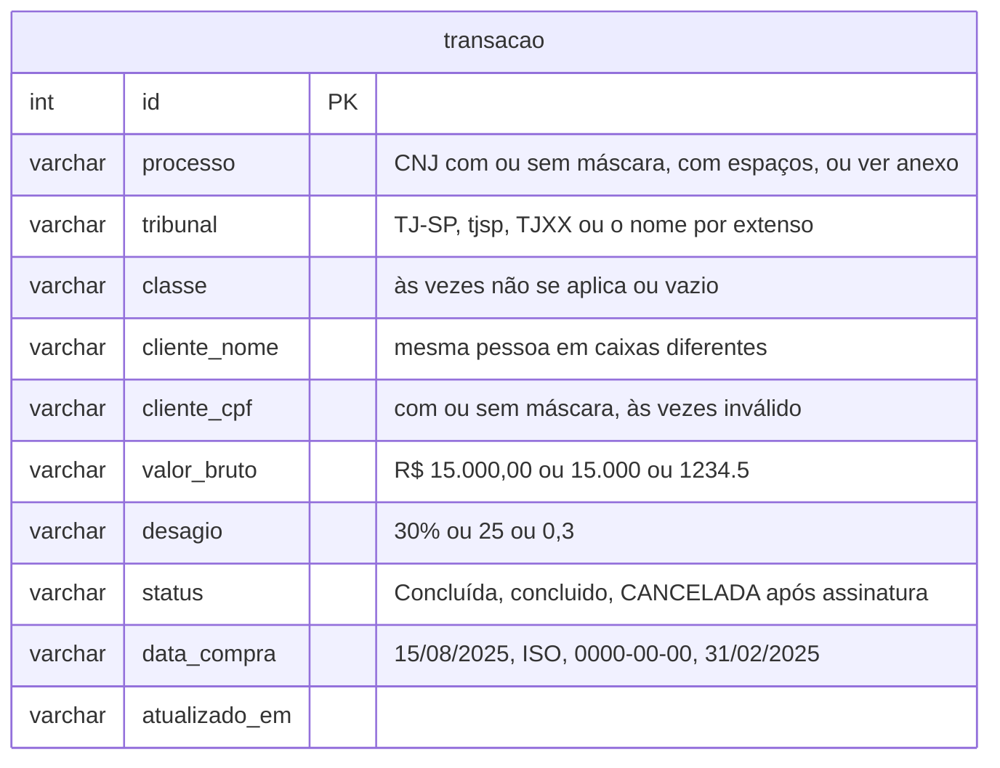
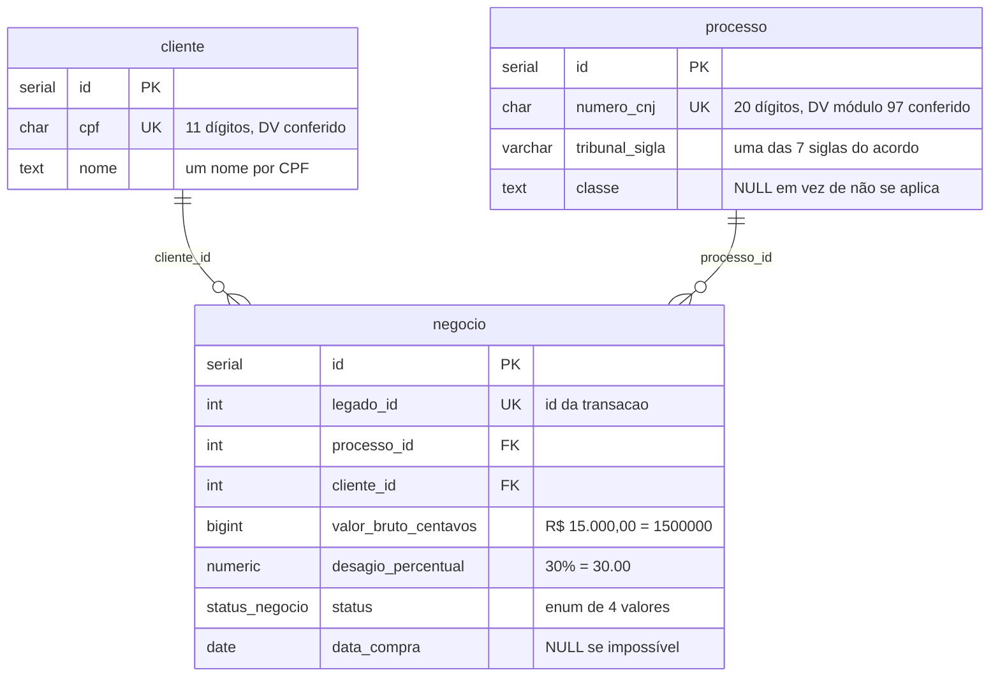
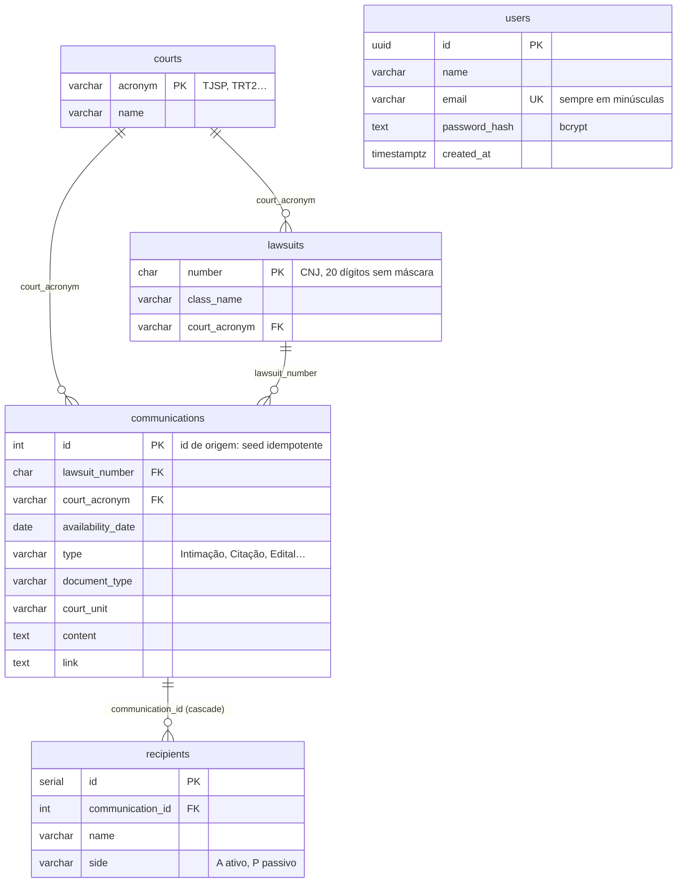

# Banco de dados: antes e depois

Dois "antes e depois" neste projeto:

1. **[P1: a migração do legado](#1-p1-a-migração-do-legado)**: uma tabela única e larga do MySQL,
   quase toda em `VARCHAR`, preenchida à mão por anos, vira 3 tabelas normalizadas com chaves e tipos.
2. **[A aplicação](#2-a-aplicação-o-banco-no-neon)**: o JSON da API de comunicações do CNJ vira o
   Postgres que roda no Neon.

Os diagramas são escritos em [Mermaid](https://mermaid.js.org/syntax/entityRelationshipDiagram.html).
O GitHub desenha a imagem direto na página, e o diagrama fica versionado como texto, ao lado do
schema. Fontes: [`legado.csv`](../problemas/01-migracao/legado.csv) e
[`schema-novo.sql`](../problemas/01-migracao/schema-novo.sql) na P1; a
[migration inicial](../api/prisma/migrations/20261125224454_init/migration.sql) na aplicação.

---

## 1. P1: a migração do legado

### Antes: uma tabela, 11 colunas, tudo texto



Cliente e processo se repetem a cada linha. Nada impede o mesmo dado de entrar em formatos
diferentes. Na amostra de 13 linhas:

| Mesmo dado | Como aparece no legado |
|---|---|
| Processo | `8990609-72.2021.8.26.0375` · `89906097220218260375` · `" 9777561-58.2021.8.19.0520 "` · `ver anexo` |
| Tribunal | `TJ-SP` · `tjsp` · `Tribunal de Justiça do Rio de Janeiro` · `TJXX` |
| CPF | `447.712.782-02` · `44771278202` · `111.111.111-11` (inválido) |
| Valor | `R$ 15.000,00` · `15.000` · `1234.5` · vazio |
| Deságio | `30%` · `25` · `0,3` · `30,5%` |
| Data | `15/08/2025` · `2025-09-02` · `2025-08-15 23:40:00` · `0000-00-00` · `31/02/2025` |

### Depois: 3 tabelas, chaves naturais únicas e tipos de verdade



### Coluna antiga → coluna nova

| Legado (`transacao`) | Novo | Regra |
|---|---|---|
| `id` | `negocio.legado_id` | Uma linha vira um negócio (acordo do time) |
| `processo` | `processo.numero_cnj` | Só dígitos + dígito verificador; sem CNJ válido, rejeita |
| `tribunal` | `processo.tribunal_sigla` | Normaliza para a sigla; se não existe, usa o tribunal do próprio CNJ, com aviso |
| `classe` | `processo.classe` | Placeholder vira `NULL`; fica a classe preenchida mais recente |
| `cliente_nome` | `cliente.nome` | Um nome por CPF: o bem formatado, da linha mais recente |
| `cliente_cpf` | `cliente.cpf` | Só dígitos + DV; CPF inválido rejeita (juntaria pessoas diferentes) |
| `valor_bruto` | `negocio.valor_bruto_centavos` | Vírgula é decimal; ponto + 3 dígitos é milhar; grava em centavos |
| `desagio` | `negocio.desagio_percentual` | `0,3` sem `%` vira 30%, com aviso |
| `status` | `negocio.status` | De-para do acordo, sem diferenciar caixa e acento; sem de-para, rejeita |
| `data_compra` | `negocio.data_compra` | 3 formatos → `DATE`; data impossível vira `NULL`, com aviso |
| `atualizado_em` | — | Não migra: só decide qual linha vence em duplicatas e nomes |

**Resultado:** 13 linhas → **8 negócios, 5 clientes, 5 processos**, mais **5 rejeitados** (cada um com
todos os motivos) e **5 avisos** para revisão humana. O detalhe de cada decisão está na
[P1 do RESPOSTAS.md](../RESPOSTAS.md#p1--migração-entre-bancos-com-estruturas-diferentes-) e o
código em [`problemas/01-migracao/solucao/`](../problemas/01-migracao/solucao/).

---

## 2. A aplicação: o banco no Neon

### Antes: um documento JSON por comunicação

[`dados/comunicacoes.json`](../dados/comunicacoes.json) segue o formato da API pública do CNJ
(120 comunicações). Trecho de um item:

```json
{
  "id": 418230064,
  "data_disponibilizacao": "2025-06-10",
  "siglaTribunal": "TJMS",
  "tipoComunicacao": "Citação",
  "nomeOrgao": "11ª Vara - Comarca de Campo Grande",
  "texto": "Cite-se a parte ré para, querendo, apresentar contestação…",
  "numero_processo": "54490243320218120119",
  "numeroprocessocommascara": "5449024-33.2021.8.12.0119",
  "nomeClasse": "Cumprimento de sentença contra a Fazenda Pública",
  "meio": "D",
  "meiocompleto": "Diário de Justiça Eletrônico Nacional",
  "destinatarios": [{ "nome": "Gustavo Ribeiro", "polo": "P" }, { "nome": "Beatriz Silva Santos", "polo": "A" }],
  "destinatarioadvogados": [{ "advogado": { "nome": "…", "numero_oab": "…", "uf_oab": "RJ" } }]
}
```

O processo e a classe se repetem em cada comunicação do mesmo processo, o número vem duas vezes
(com e sem máscara), o tribunal é só uma string e os destinatários ficam aninhados.

### Depois: 5 tabelas



`users` não se liga às outras: as comunicações são públicas para quem está logado, e não há dado
por usuário.

### Campo do JSON → coluna

| JSON (CNJ) | Coluna | Observação |
|---|---|---|
| `id` | `communications.id` | Mantém o id de origem: rodar o seed de novo não duplica |
| `numero_processo` | `lawsuits.number` e `communications.lawsuit_number` | Só dígitos; a máscara é aplicada na saída da API |
| `numeroprocessocommascara` | — | Descartado: é o mesmo número |
| `siglaTribunal` | `courts.acronym` (FK) | Nome do tribunal vem de [`tribunais.json`](../dados/tribunais.json) |
| `nomeClasse` | `lawsuits.class_name` | Uma vez por processo, não por comunicação |
| `data_disponibilizacao` | `communications.availability_date` | `DATE`, sem fuso |
| `tipoComunicacao`, `tipoDocumento`, `nomeOrgao`, `texto`, `link` | `type`, `document_type`, `court_unit`, `content`, `link` | |
| `destinatarios[]` | `recipients` (1 linha por destinatário) | Apagar a comunicação apaga os destinatários |
| `meio`, `meiocompleto`, `destinatarioadvogados` | — | Descartados: sempre DJEN; advogados não aparecem em nenhuma tela |

**Índices** (os filtros da listagem, já na ordem "mais recente primeiro"):

| Índice | Atende |
|---|---|
| `communications (availability_date DESC, id DESC)` | Lista sem filtro e por período, com desempate estável na paginação |
| `communications (court_acronym, availability_date DESC)` | Filtro por tribunal |
| `communications (lawsuit_number, availability_date DESC)` | Busca por número e a página do processo |
| `lawsuits (court_acronym)`, `recipients (communication_id)` | As chaves estrangeiras |
| `users (email)` único | Login e o 409 de e-mail repetido, pela constraint (sem corrida) |
